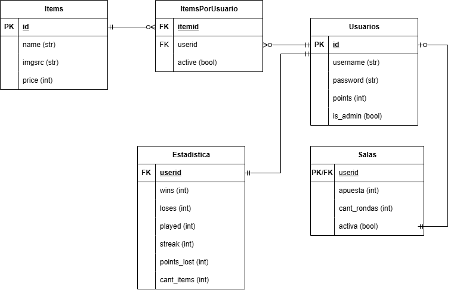
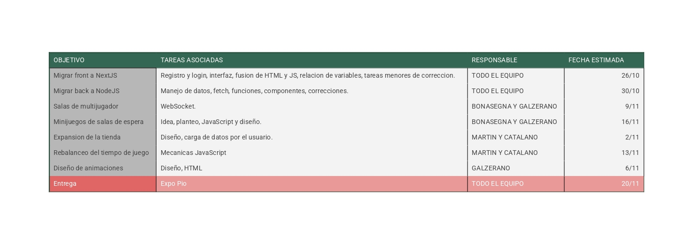

# 2026-TPF-G03
**Integrantes:** Ash Bonasegna, Camila Galzerano,  Franco Martin Moratti y Facundo Catalano.

## PROYECTO
**Nombre de la aplicación:** Blackjack Pio MK II 
**Descripción general:** Un blackjack que integra funciones de un jugador y multijugador, un apartado gráfico pixel art, tienda digital con interfaz personalizable y una jugabilidad atrapante. 
**Público objetivo:** Jugadores casuales, aficionados a los juegos de probabilidad y cartas. 
**Funcionalidades principales:** El juego cuenta con un modo de un solo jugador, así como una opción para poder jugar entre varias personas en una sala contra un crupier digital. Los usuarios pueden comprar objetos en la tienda con puntos ganados en los distintos modos para poder personalizar sus perfiles de usuario. 

## ALCANCE
**Funcionalidades desarrolladas:** Deseamos incorporar salas multijugador en tiempo real por medio de WebSocket, además de la posibilidad de añadir objetos a la tienda que modifican los resultados del juego para un mejor gameplay. Además de eso, cuenta con un set de items coleccionables que aparecen en la página principal una vez conseguidos a través de un sistema de gacha. 
 
**Principales características**
- Modo de un solo jugador 
- Salas para jugar entre muchos usuarios 
- Tienda de objetos con variedad de artículos y personalización 
- Interacciones y medios de entretenimiento variados 
- Estética pixel art 
- Pequeños easter eggs para divertir a los más curiosos 
- Mejoras en la gestión de los turnos con tiempo y visualización 

## DISEÑO INICIAL
[Canva](https://canva.link/2v4mlj6ck1vcdn9) con diseños de interfaz, ahora desactualizados.

## DER

## PLANIFICACION

## PARA EJECUTAR:
Si se planea ejecutar el backend y frontend en el mismo dispositivo, se debe tener instalado node.js y los archivos .env correspondientes en la carpeta "back"
Tanto para el backend como para el frontend, se debe abrir un cmd en la carpeta y correr el comando "npm install"
Después, para el primero se corre "npm run pio/home" (uno o el otro, dependiendo de desde dónde se ejecuta), y para el segundo "npm run build".
Para entrar al juego se debe ingresar a "http://localhost:3000"